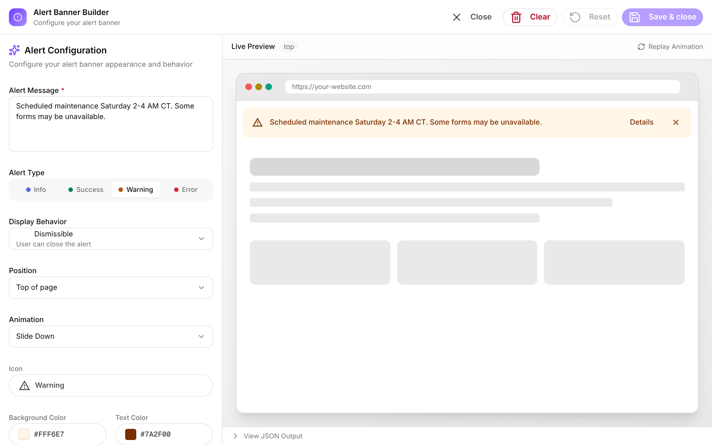

# Alert Banner Builder

A Sitecore Marketplace app that gives content authors a visual editor for site alert banners, right inside the SitecoreAI Page builder. Authors pick a message, severity, colors, icon, call to action and display behavior, see a live preview, and the result is saved to the field as JSON. Your head app reads that JSON and renders the banner however your design system wants.

It runs as a **Page builder custom field** extension, so it shows up wherever you add the field to a template.



## What authors can configure

| Option | Values |
| --- | --- |
| Message | Plain text, required |
| Type | `info`, `warning`, `error`, `success` (each sets default colors and icon) |
| Display behavior | `dismissible`, `persistent`, `timed` (auto-hide after N seconds) |
| Icon | 12 Material Design Icons |
| Colors | Background and text, preset palette or any hex value |
| Call to action | Optional button with text, URL and style (`primary`, `secondary`, `text`) |
| Position | `top`, `bottom`, `fixed`, `inline` |
| Animation | `none`, `slide-down`, `slide-up`, `fade-in`, `bounce`, `shake` |

CTA links are validated before saving. Only relative paths and `http(s)`, `mailto:` and `tel:` links are accepted.

## Field value

The field stores a JSON string like this:

```json
{
  "message": "Scheduled maintenance Saturday 2-4 AM CT.",
  "type": "warning",
  "displayOption": "dismissible",
  "dismissible": true,
  "icon": "alert-outline",
  "backgroundColor": "#FFF6E7",
  "textColor": "#7A2F00",
  "cta": { "text": "Details", "url": "/status", "style": "primary" },
  "position": "top",
  "animation": "slide-down"
}
```

`timedDuration` (seconds) is present when `displayOption` is `timed`. `cta` is omitted when the author didn't add one. An empty field means "no banner". The full type lives in [`types/alert-banner.ts`](types/alert-banner.ts).

## Rendering it in your head app

[`examples/content-sdk/AlertBanner.tsx`](examples/content-sdk/AlertBanner.tsx) is a drop-in Content SDK (Next.js) component. It parses the field defensively, re-validates colors and the CTA URL, handles dismiss and timed hide, and remembers a dismissal for the browser session. Styling is left to you through `alert-banner--*` class names.

Copy it into your app, register it in your component map, and rename the `AlertBanner` field in the props type to match your template.

## Getting started

Requirements: Node.js 20.9 or later (Next.js 16), access to the Sitecore Cloud Portal, and a SitecoreAI environment.

```bash
npm install
npm run dev        # http://localhost:3000
```

The app only works inside SitecoreAI. Opened directly in a browser it shows a "has to run inside SitecoreAI" message, which is expected.

To try it in SitecoreAI:

1. Register a custom app in the Cloud Portal and point it at your URL (your local dev server for development, your deployed URL after that). See [Custom Marketplace apps](https://doc.sitecore.com/mp/en/developers/marketplace/custom-marketplace-apps.html).
2. Enable the **Page builder custom field** extension point for the app and install it in your organization.
3. Add a field to your template with type **Marketplace Types > Plugin** and set its **Source** to your Marketplace app ID, then reload the Page builder. See [Enable a custom field in the SitecoreAI Page builder](https://doc.sitecore.com/mp/en/developers/marketplace/enable-a-custom-field-in-the-sitecoreai-page-builder.html).

## Scripts

| Script | What it does |
| --- | --- |
| `npm run dev` | Local dev server |
| `npm run build` | Production build |
| `npm run lint` | ESLint (Next.js core web vitals + TypeScript rules) |
| `npm run typecheck` | `tsc --noEmit` |

## Deploying

It's a standard Next.js app, so Vercel works out of the box: import the repo, deploy, then put the production URL in your app registration in the Cloud Portal. Any host that runs Next.js 16 is fine.

## Project layout

```
app/                     layout (wraps everything in MarketplaceProvider) and page
components/alert-banner/ builder, configuration panel, live preview, pickers
components/providers/    Marketplace SDK connection (retry, error state, field value helpers)
components/ui/           Blok / shadcn UI primitives
types/alert-banner.ts    field JSON type, defaults, presets
examples/content-sdk/    rendering component for your head app (not part of this build)
```

## How it talks to Sitecore

`components/providers/marketplace.tsx` initializes `ClientSDK` once per tab with the `XMC` module, queries `application.context`, and retries a few times before showing an error with a "Try again" button. The builder then uses:

- `client.getValue()` to load the current field value
- `client.setValue(json, true)` to save it and reload the Page builder canvas
- `client.closeApp()` to close the field dialog after saving, same as the Sitecore custom field sample

## Contributing

Issues and pull requests are welcome. See [CONTRIBUTING.md](CONTRIBUTING.md).

## License

[MIT](LICENSE)
